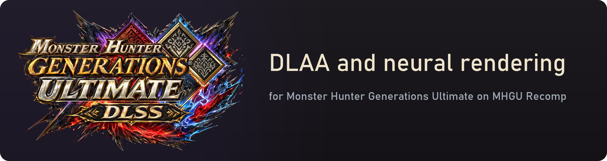
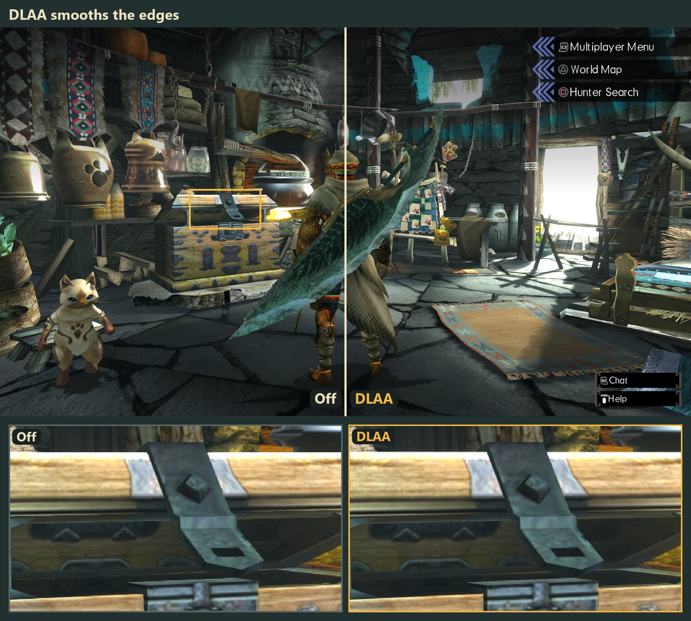
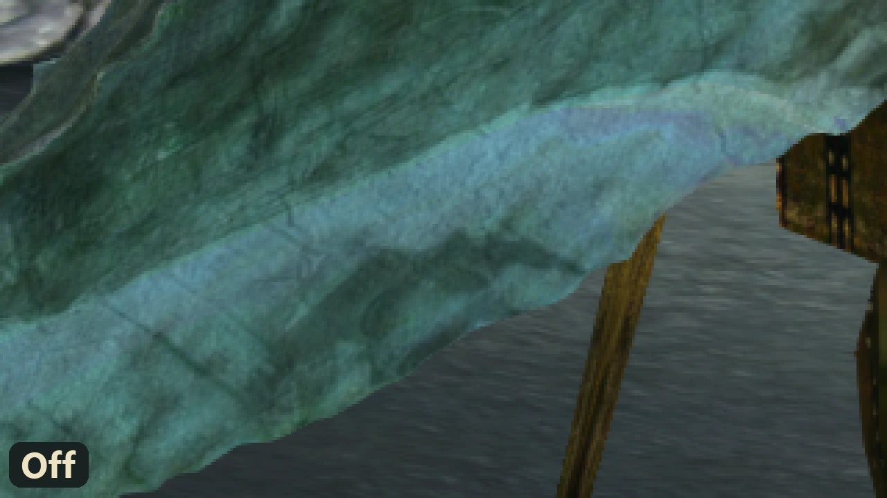
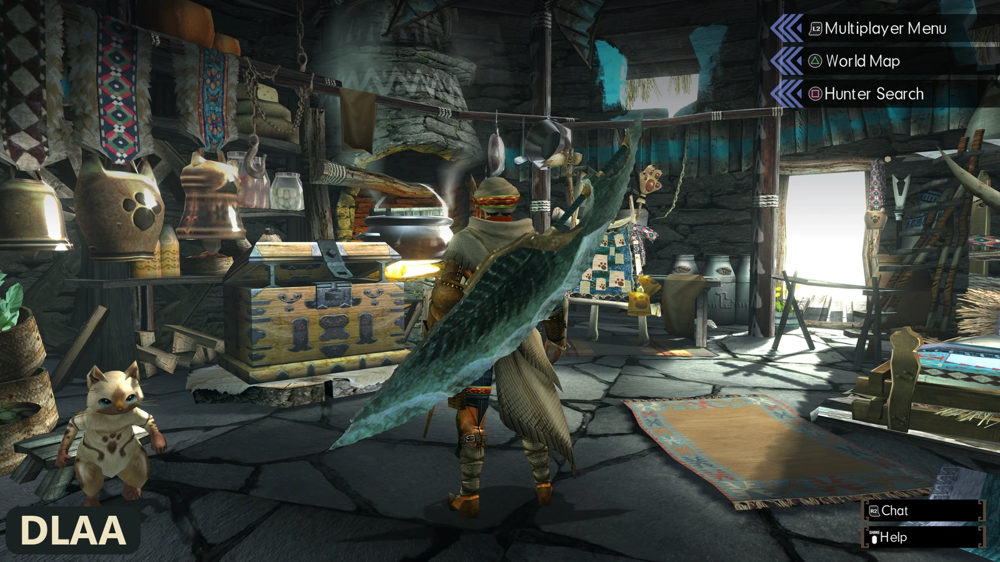
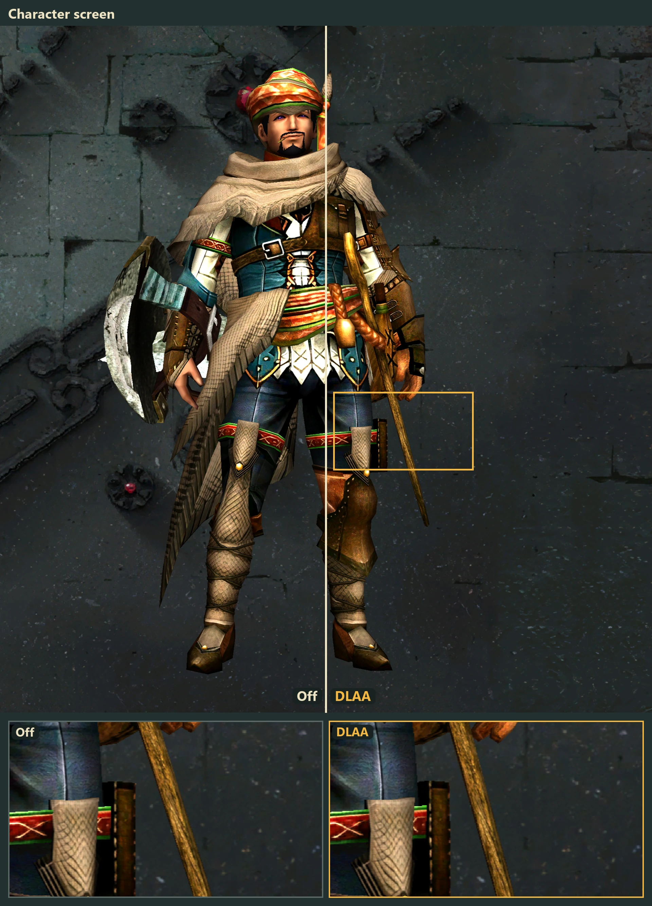

<p align="center">
  
</p>

<p align="center">
  <a href="https://github.com/lick-mee/mhgu-dlss/releases/latest"><b>Download the latest release</b></a>
  &nbsp;&nbsp;|&nbsp;&nbsp;
  <a href="https://lick-mee.github.io/mhgu-dlss/"><b>Open the illustrated guide</b></a>
</p>

NVIDIA DLSS for [MHGU Recomp](https://github.com/morerokk/MHGURecomp): DLAA (DLSS as anti-aliasing, with camera motion vectors and sub-pixel jitter) and,
on top of it, DLSS 5 neural rendering. It's a `vulkan-1.dll` proxy next to `mhgurecomp.exe` that forwards every
Vulkan call to the system's loader and adds the DLSS passes to the game's frame. NVIDIA's DLLs aren't part of
this repository or its releases: bring your own.

**Off by default.** Nothing changes until you switch it on in the Forge menu.

**[Open the illustrated guide](https://lick-mee.github.io/mhgu-dlss/):** a before/after comparison you can zoom
into, the install steps and a working copy of the in-game menu. The release zip has the same guide for offline
use, in its `mhgu-dlss-guide` folder.

## What it changes



Up close it's easy to see: the same spot switching between off and DLAA. The stair steps along the blade go away.



Neural rendering on top of DLAA relights the scene and brings out the materials:



On the character screen (neural rendering doesn't run there):



## Install


1. Download `mhgu-dlss-v<version>.zip` from [Releases](https://github.com/lick-mee/mhgu-dlss/releases) and
   extract it into the folder with `mhgurecomp.exe` (`vulkan-1.dll` and `mhgudlss_nvngx.dll` land next to it).
2. Put NVIDIA's `nvngx_dlss.dll` (DLSS/DLAA) there too and, for neural rendering, `nvngx_dlssnr.dll`. They're
   not in the zip or this repository: bring your own.
3. Start the game and switch it on in the Forge menu (below).

Needs an NVIDIA RTX card and a current driver. Uninstall: delete `vulkan-1.dll` and `mhgudlss_nvngx.dll`.

## Forge menu

Press **Insert** in game, open **Plugin UI** and then **DLSS**:

- **DLAA**: on/off. While it's on the game's FXAA is off.
- **DLAA model**: Default, J, K, L or M (NVIDIA's presets; K is the usual one for DLAA). Switching rebuilds
  the DLSS feature on the next frame.
- **Camera motion vectors**: on keeps scenery and fog clean in motion; off is only for comparing.
- **DLSS 5 neural rendering**: on/off, runs after DLAA.
- **Neural rendering model**: Default, A or B. Runtime 310.9.16 has two networks (B is its default, newer and
  faster; A is the previous one); 310.8 has one and ignores this. The menu shows the runtime's version.
- **Neural rendering preset**: Light, Moderate, Default, Reference, Overdrive.
- **Neural rendering strength**: 0 (none) to 2 (doubled); 1 is what the network made.

Every change is saved right away to `[DLSS]` in `mhgurecomp.ini` and used at the next start.

## mhgurecomp.ini

All keys are optional; the menu writes the ones it changes. Defaults in brackets.

```ini
[DLSS]
Mode = Off              ; Off or DLAA [Off]
Preset = Default        ; Default, J, K, L, M
MotionVectors = Camera  ; Camera or Off
NeuralRendering = Off   ; On or Off [Off]
NRModel = Default       ; Default, A or B
NRPreset = Default      ; Light, Moderate, Default, Reference, Overdrive
NRStrength = 1.0        ; 0 to 2
```

`mhgu-dlss.log` next to the exe says what it found and what failed.

## How the menu gets in

`mhgurecomp.exe` exports its ImGui (cimgui names) and `forge_imgui_run`, which draws the Forge plugins' entries.
The overlay calls that once inside "Plugin UI"; the proxy points that one call at a small stub that runs it and
then draws the DLSS entry. If the exe is another build and the call isn't found, the log says so and the ini
keeps working as before.
