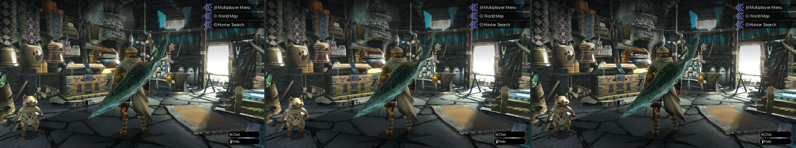
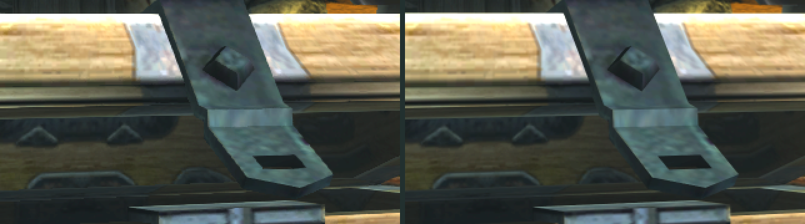
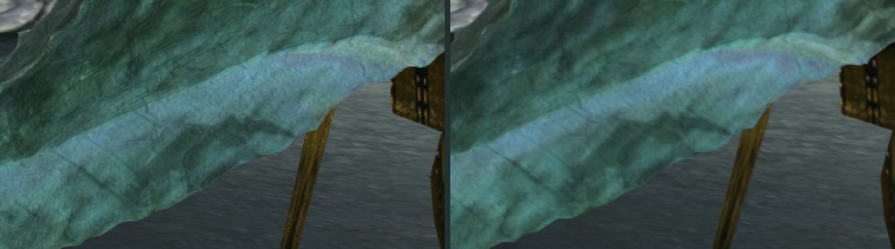
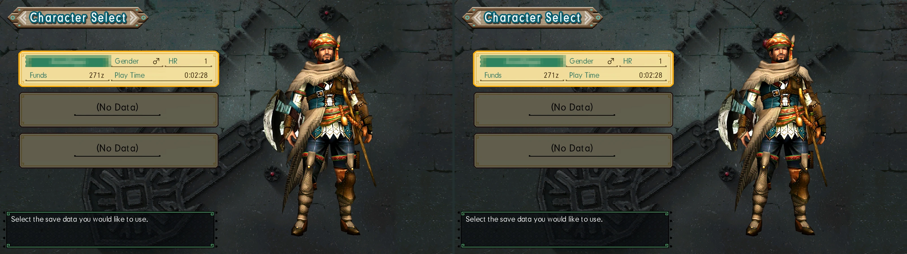
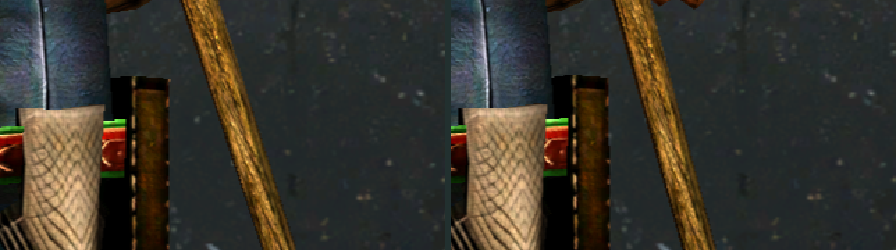
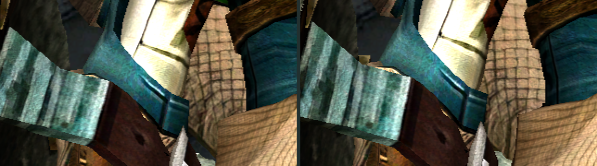

# mhgu-dlss

NVIDIA DLSS for MHGU Recomp: DLAA (DLSS as anti-aliasing, with camera motion vectors and sub-pixel jitter) and,
on top of it, DLSS 5 neural rendering. It's a `vulkan-1.dll` proxy next to `mhgurecomp.exe` that forwards every
Vulkan call to the system's loader and adds the DLSS passes to the game's frame. Private: the DLSS 5 runtime it
talks to isn't public.

**Off by default.** Nothing changes until you switch it on in the Forge menu.

**Interactive guide:** [`docs/index.html`](docs/index.html) has a comparison slider with a loupe on real game
pixels, the install steps and a working copy of the Forge menu. GitHub shows HTML files of a private repository
as source only, so download the repository (Code → Download ZIP) and open that file in your browser.

## What it changes

The hunter's house at 4K: off, DLAA, DLAA + neural rendering.



Up close, game pixels drawn twice as large. Left off, right DLAA: the stair-stepped edges go, the detail stays.

The strap on the chest:



The edge of the hunter's blade:



### Character screen

Off and DLAA (neural rendering doesn't run on this screen).



The sword:



Sleeve, belt and cloth (the hunter sways a little between the two shots):



## Install

No build tools needed:

1. Download `mhgu-dlss-v<version>.zip` from [Releases](https://github.com/lick-mee/mhgu-dlss/releases) and
   extract it into the folder with `mhgurecomp.exe` (`vulkan-1.dll` and `mhgudlss_nvngx.dll` land next to it).
2. Put NVIDIA's `nvngx_dlss.dll` (DLSS/DLAA) there too and, for neural rendering, `nvngx_dlssnr.dll`. They're
   not in the zip or this repository: bring your own.
3. Start the game and switch it on in the Forge menu (below).

Needs an NVIDIA RTX card and a current driver. Uninstall: delete `vulkan-1.dll` and `mhgudlss_nvngx.dll`.

## Forge menu

Press **Insert** in game, open **Plugin UI** and then **DLSS**:

- **DLAA**: on/off. While it's on the game's FXAA is off.
- **DLAA model**: Default, J, K, L or M (NVIDIA's presets; K is the usual one for DLAA). Switching rebuilds
  the DLSS feature on the next frame.
- **Camera motion vectors**: on keeps scenery and fog clean in motion; off is only for comparing.
- **DLSS 5 neural rendering**: on/off, runs after DLAA.
- **Neural rendering model**: Default, A or B. Runtime 310.9.16 has two networks (B is its default, newer and
  faster; A is the previous one); 310.8 has one and ignores this. The menu shows the runtime's version.
- **Neural rendering preset**: Light, Moderate, Default, Reference, Overdrive.
- **Neural rendering strength**: 0 (none) to 2 (doubled); 1 is what the network made.

Every change is saved right away to `[DLSS]` in `mhgurecomp.ini` and used at the next start.

## mhgurecomp.ini

All keys are optional; the menu writes the ones it changes. Defaults in brackets.

```ini
[DLSS]
Mode = Off              ; Off or DLAA [Off]
Preset = Default        ; Default, J, K, L, M
MotionVectors = Camera  ; Camera or Off
NeuralRendering = Off   ; On or Off [Off]
NRModel = Default       ; Default, A or B
NRPreset = Default      ; Light, Moderate, Default, Reference, Overdrive
NRStrength = 1.0        ; 0 to 2
```

`mhgu-dlss.log` next to the exe says what it found and what failed.

## Build

Only for changing the code; the release zip is all you need to play. Needs Zig (`ZIG=`, default `H:/Games/MHGU/tools/zig-x86_64-windows-0.17.0/zig.exe`), Python 3 with `pefile`,
the Vulkan headers and NVIDIA's DLSS SDK headers (`SDK=`, default `H:/Games/MHGU/tools/sdk` with
`vulkan-headers/include` and `dlss/include`).

```sh
sh build.sh            # build/vulkan-1.dll, build/mhgudlss_nvngx.dll
sh build.sh --install  # and copy them next to mhgurecomp.exe
sh build.sh --zip      # and pack dist/mhgu-dlss-v<version>.zip (VERSION in build.sh)
python shaders/compile.py  # after changing a shader: rewrites src/shaders.h
```

`gen_exports.py` writes `src/exports.S` (forwarders for every export of the system `vulkan-1.dll`) on each
build. `FRAME.md` is the map of the game's render passes the insertion points come from.

## How the menu gets in

`mhgurecomp.exe` exports its ImGui (cimgui names) and `forge_imgui_run`, which draws the Forge plugins' entries.
The overlay calls that once inside "Plugin UI"; the proxy points that one call at a small stub that runs it and
then draws the DLSS entry. If the exe is another build and the call isn't found, the log says so and the ini
keeps working as before.
